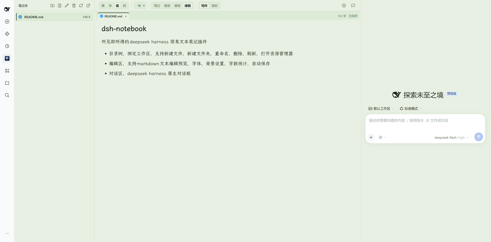
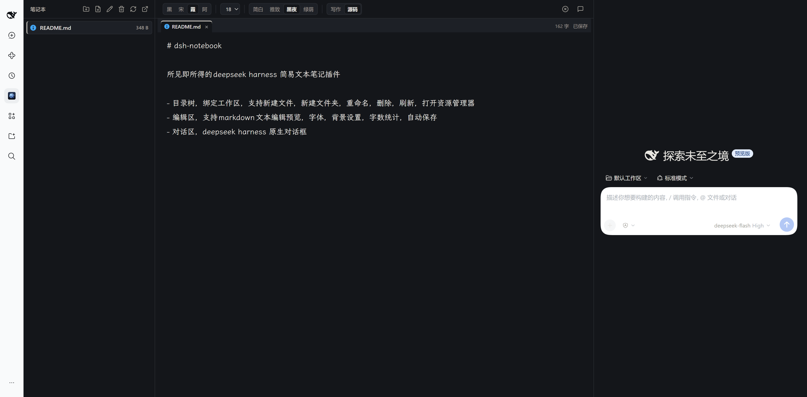

# 笔记本 (dsh-notebook)

所见即所得的deepseek harness简易文本笔记插件

- 目录树，绑定工作区，支持新建文件，新建文件夹，重命名，删除，刷新，打开资源管理器
- 编辑区，支持多文件浏览，markdown编辑预览，字体，背景设置，字数统计，自动保存
- 代码高亮，markdown围栏代码块与源码文件都按语言着色高亮；
- 对话区，deepseek harness 原生对话框

# 预览效果






## 安装

deepseek harness 对话安装

```
安装 @zmskco/dsh-notebook 这个插件
```

插件选项里面 Github 地址安装

```
https://github.com/zmskco/dsh-notebook
```

插件选项里面 npmjs 名称安装

```
@zmskco/dsh-notebook
```

## 代码高亮

围栏代码块（markdown 里的 \`\``块）与源码文件（`*.py**`、`*.go`、`Dockerfile\` …）用同一套配色。

**配色来自 Dracula Theme 官方规范**，暗色与亮色是同名主题的两个官方变体：

| 纸张 | 配色方案 | 代码背景 |
|---|---|---|
| 黑夜 | Dracula Classic（暗色） | `#282a36` |
| 简白 / 雅致 / 绿荫 | Alucard Classic（亮色） | `#fffbeb` |

选纸张即选亮暗：选「黑夜」是暗色，选其余三张是亮色。代码画在主题**自己的背景色**上而不是纸张的灰底——这是量出来的决定：同一套 Alucard 色值放在绿荫原来的灰绿代码底上，16 个角色里有 6 个低于 WCAG AA（3.86–4.49）；放在 Alucard 自己的 `#fffbeb` 上无一低于，最紧的一个也有 4.80:1。

角色映射按规范的 Token Classification 表，不是凭感觉配的：关键字 Pink、函数/类 Green、类型与内建 Cyan、字符串 Yellow、数字与常量 Orange、注释 Comment、变量 Foreground、删除 Red。

**一处已知的对比度不足，是主题本身的**：Dracula 的注释色 `#6272a4` 在它自己的 `#282a36` 背景上只有 3.03:1，低于 AA 的 4.5。官方主题就是这样发布的——照着做才叫还原 Dracula，改掉就不是了。Alucard 那一半没有这个问题（注释 5.56:1）。`scripts/check-client.mjs` 把「哪些色值在哪个面上低于 AA」逐条钉死，加一条都要有人明确决定。

```
pnpm install           # prepare 顺带跑一次 build
pnpm run build         # host(tsc) + client(tsdown) + 产物契约检查
pnpm test              # 类型检查 + 沙箱 + Host 冒烟
pnpm run vendor:icons  # 升级 Material Icon Theme 后重新收录图标（--dry-run 只校验）
npm pack --dry-run     # 看 tarball 内容
```

## 许可

MIT
