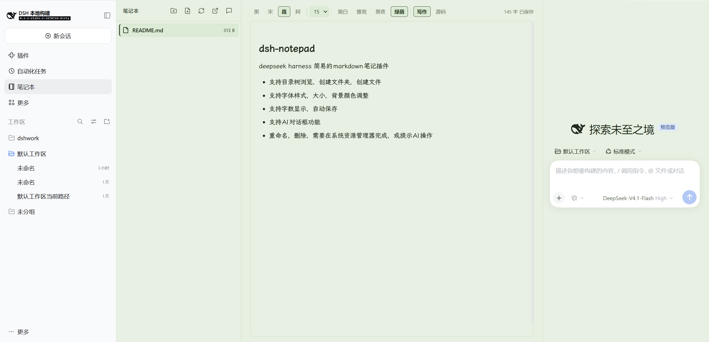
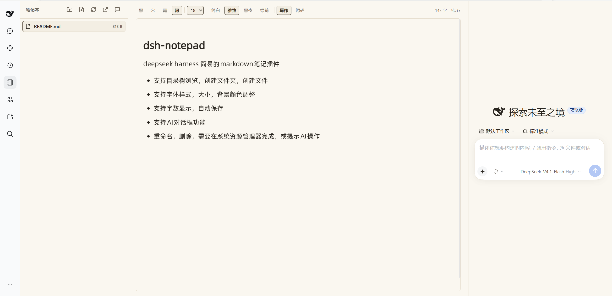

# 笔记本 (Notebook)

DeepSeek Harness（DSH）插件：**工作区里的 markdown 笔记本** —— 目录树、所见即所得编辑、自动保存，右侧嵌着 AI 对话。

- **Host 半边**：一个认证过的 JSON 控制面（读树、读写文件、建文件/目录、打开资源管理器、写工作区 README）。
- **Client 半边**：侧边栏入口 + 三栏面板（目录 · 文档 · 对话）。
- **没有工具、没有 skill、没有渲染管线**：面板编辑的就是工作区里的真实文件，模型用自己的 `read`/`write` 工具读写同一批文件。

# 预览效果





## 安装

deepseek harness 对话安装

```text
安装 @zmskco/dsh-notebook 这个插件
```

插件选项里面 Github 地址安装

```text
https://github.com/zmskco/dsh-notebook
```

插件选项里面 npmjs 名称安装

```text
@zmskco/dsh-notebook
```


## 功能

| 区域 | 用法 |
| --- | --- |
| 目录区（左） | 工作区文件树：点文件夹展开/折叠，点文件在中间打开（多次点开多个标签页）；行首是 **Material Icon Theme** 的类型图标（见下） |
| 文档区（中） | 顶部是**固定**的排版工具栏 + 文件标签页；下面是正文，只有正文滚动。`写作` / `源码` 两个按钮切换，字数与保存状态在标签行右端 |
| 对话区（右） | 当前会话的对话；可隐藏（标题行最右端），隐藏只是不绘制，不卸载 |

- **两个新建图标 + 刷新 + 打开资源管理器**在目录列标题行右端，紧挨对话开关：`new-dir` / `new-file` / `refresh` / `reveal`。
- **右键菜单**：树里任意一行（以及列标题「笔记本」）右键，出六个动作——新建文件、新建文件夹、重命名、删除、刷新、在资源管理器中打开。见下。
- 新建是**就地命名**：点图标后目标目录里出现一行空名字，回车创建；空名字回车或 Esc 取消；输入法组字时回车不误触发。
- **文件名就是输入的名字，不补 `.md`**：输「第一章」得到 `第一章`；输「素材.md」得到 `素材.md`。重名时在扩展名前加序号（`名-2.md`）。
- **首次打开写一份 `README.md` 到工作区根目录**（`op=ensure-readme`），内容固定，且**只写不覆盖**。
- **排版**：字体 `黑 / 宋 / 霞 / 阿`（本机字体栈，不打包字体文件）、字号 13–24、纸色 `简白 / 雅致 / 黑夜 / 绿荫`——**纸色作用于整个面板**（左栏、编辑区、对话区同一张纸），默认简白。
- **编辑器**：ProseMirror 内核；markdown ↔ 文档模型双向转换，schema 表达不了的块（front matter、表格）作为 raw 块逐字保留；**文件里单个换行在页面上就是换行**（写回为行尾两空格 + 换行）。
- **自动保存**：停笔 900ms 写盘，`Ctrl/Cmd+S` 立即保存；切换/关闭标签页先把该文件缓冲写掉。**没有保存按钮**。
- **目录树**：`node_modules` 与点开头条目不列出；大目录有 2000 条上限。

## 编辑区：固定的工具栏 + 标签页

文档区被分成两段：**上面一段固定不动，下面一段滚动**。

```
┌─ 排版工具栏（黑 宋 霞 阿 | 13 ▾ | 简白 雅致 黑夜 绿荫 | 写作 源码）   ← 永远不动
├─ 标签页 [▤ 第一章 ×] [▤ 素材.md ●×]              212 字  未保存  ← 永远不动，横向滚动
├──────────────────────────────────────────────────────────────
│  正文（渲染页或源码）                              ← 只有这里滚动
└──────────────────────────────────────────────────────────────
```

- **为什么固定**：工具栏是「这份文档怎么显示」的开关，滚到 800 行之后再往回找它，就变成了不用。固定的是 `flex:none` 的 `editorHead`，编辑区整列 `overflow:hidden`（列不能滚，否则固定头会被一起卷走），滚动只落在正文自己的容器里（ProseMirror 的滚动宿主或源码 textarea）。
- **字数与保存状态放在标签行右端，不放在工具栏里**：工具栏是 `flex-wrap:wrap` 的，窄栏时会换行；一个字数在打字时多一位，就可能让工具栏多折一行、把正文往下顶。标签行不换行，这两项在那里是固定的。
- **高度稳定**：标签行即使一个文件都没开也保留 36px，所以开第一个文件不会让正文跳动；工具栏在极矮的面板里自己出纵向滚动条，而不是被裁掉。
- **多文件**：点目录里的文件就开一个标签页；**每个标签页有自己的缓冲、脏标记和写作/源码模式**，切走再切回来不会重新读盘，未保存的句子还在。同一个文件再点一次只是把它的标签页切到前面，不重读。
- **标签标题 = 图标 + 文件名**，图标**就是目录树那一枚**（同一个 `TreeIcon` 组件、同一套 Material Icon Theme 关联表，只是按 14px 而非 16px 画），所以 `.md` 章在树上和标签上长得一样。**同名文件会自动带上目录名**（`笔记.md · 第一章`），否则一章一个文件夹的工作区里会出现两个一样的标签。
- **未保存**：工具栏右端有「未保存」三个字；标签上的小圆点只出现在**不是当前页**的脏标签上——同一行里出现两个「未保存」信号，读起来像两个问题。
- **关闭**：`×`（悬停或当前页显示）、鼠标中键、或在标签上按 `Delete`/`Backspace`。关掉有改动的那一页会**先写盘再关**；**写盘失败就不关**，那一页留着，字还在（错误显示在上方横幅）。关闭后焦点落到右邻，关最后一个落到左邻，全关掉就是空编辑器（工具栏仍在，好让下一个文件沿用当前的字体/纸色）。
- **不会互相覆盖**：续读会等同一路径正在进行的写盘落盘；一次读盘**不会覆盖你已经敲过字的缓冲**（读到一半就开始写的那句话不会被旧内容顶掉）；自动保存盯着**所有**脏标签，不只是当前页。
- **键盘**：整个标签条只有一个 Tab 停靠点（当前页），`←`/`→` 切换并带走焦点，`Enter`/`空格` 激活，`Delete` 关闭，`Ctrl/Cmd+S` 保存**所有**脏标签。
- **无障碍**：`role=tablist` / `role=tab` / `role=tabpanel` 齐备，每个标签 `aria-controls` 指向正文、正文 `aria-labelledby` 指向当前标签，脏标签的可及名字带「未保存」。
- 树里**已打开但不是当前页**的文件，行名用品牌色、但没有选中条——打开是标签页的事实，不是第二个选中态。

## 目录树右键菜单

DSH 本身**支持**右键菜单：`ui-context-menu` 是 web-app bundle 的一行，它注册 `ctx.contextMenus` 服务，并通过 `ctx.slots.provideRoot` 把 `useContextMenu()` 注入每个 Slot 作用域。弹层的位置、键盘移动、焦点归还、关闭、以及「手势发生时的目标快照」都由它负责；插件只声明**目标家族**和动作。

本插件注册了**自己的目标家族** `notebookEntry`，而不是往自带的 `file` / `directory` 家族里加动作——那两个家族是文件侧栏和对话里的文件引用在用的，挂到上面会让"在这里新建文件夹"出现在别处的文件上。

**手势用的是 `ctx.contextMenus.open()`，不是 `useContextMenu()`。** 后者是 DSH 文档里的推荐路径（`provideRoot` 注入每个 Slot 作用域），但实测没有传到本面板的组件上——行上仍然是浏览器的原生菜单（返回 / 重新加载 / 另存为）。`open()` 是文档中另一条明确支持的路径（"special editors and canvases can call it directly"），所以 `apply` 在激活时取一次服务、存进模块，行自己 `preventDefault()` 后按视口坐标打开；键盘的 `Shift+F10` / ContextMenu 键同样由本插件处理，锚在行的左下角。

| 菜单项 | 行为 |
| --- | --- |
| 新建文件 / 新建文件夹 | 右键**文件夹**→建在里面；右键**文件**→建在它旁边；右键列标题或目录区空白处→建在工作区根目录 |
| 重命名 | 该行原地变成输入框，回车确认、Esc 取消、失焦也确认；默认选中主名、保留扩展名 |
| 删除 | 弹确认框，文件夹会先统计里面有多少文件并写进问题里；确认按钮是唯一的红色按钮 |
| 刷新 | 重新读一遍工作区 |
| 在资源管理器中打开 | 文件夹打开它本身，文件打开它所在的目录（Host 侧解析并校验路径，页面从不接触绝对路径） |

几处刻意的取舍：

- **整列都能触发**：右键手势绑在目录列本身（目标=工作区根），行各自绑自己的并在事件里 `stopPropagation()`。所以行上出的是该行的菜单，行之间的空白、列表末尾的空白、列标题出的都是根菜单——空工作区里想新建第一个文件，不必去点标题行的图标。没有 `stop` 的话行的事件会冒泡到列，列再开一次同一点的菜单，共享弹层会把它当成"再点一次"而关掉。
- **根目标不能改名/删除**：列标题与空白区域代表工作区本身，它不在自己的树里，没有可指向的对象。
- **重命名是一个片段，不是移动**：新名字按"单个路径段"校验，带分隔符直接 400，所以重命名不会把一章的文件夹挪到别处。
- **改名会带着标签页一起走**：标签的 path 是写盘的键，所以改完名后该文件的标签留在原位、缓冲不丢；整个文件夹改名时，其下所有标签的路径一起重写。
- **删除会关掉该路径下的所有标签**，当前页落到相邻标签上——指向一个已不存在文件的标签就是往空处写。
- **只读部署会拒绝**：文件走 `ctx.fs`（自带策略），目录走 `node:fs`（没有策略），所以 API 层对目录类操作单独做了一次只读检查，和写文件给出同一段说明。
- **没有菜单也能用**：`ui-context-menu` 不在（`ctx.get('contextMenus')` 为 undefined）时，面板照常工作，行上不绑定任何手势、保留浏览器自己的菜单——服务是可选读取的，没有写进 `inject`。

删写在 Host 侧对应两个新 op（`rename` / `delete`，另有只读的 `count` 供确认框统计）；文件用 `fs.moveFile` / `fs.deleteFile`，目录用 `node:fs` 的 `rename` / `rm`，两者都先经 `resolveInside` 证明在根内。

## 目录树图标

目录树的每个文件/文件夹行都用 **VS Code 插件 [Material Icon Theme](https://github.com/material-extensions/vscode-material-icon-theme)** 的图标，按它自己的关联规则选图：`README.md` 是 README 图标、`package.json` 是 Node 图标、`package-lock.json`/`tsconfig.json` 各有自己的标、`笔记.md` 是 markdown、`数据.yaml` 是 YAML、`src/` 是源码文件夹（展开时换成 `-open` 版）。规则顺序与插件一致，只有第 4 条是本插件的补充：

1. **完整文件名**（不区分大小写）最优先——`package.json`、`README.md`、`LICENSE`、`docker-compose.yml`；
2. 否则按**最长后缀**匹配扩展名——`.md` / `.markdown` / `.txt` / `.json` / `.jsonl` / `.yml` / `.yaml` / `.csv`；
3. 文件夹按**名字**匹配，展开/收起是两张图；
4. **没有扩展名的名字按编辑器的判定当文档**——这是唯一一处不照主题的表来画：编辑器本来就把无后缀名字当 markdown（`isMarkdownPath`，图标直接复用同一个判定，不另写一份），而新建文件的默认名字就是 `第一章` 而不是 `第一章.md`，所以这条规则决定了整本小说的大部分行；
5. 其余落到主题自己的通用 `file` / `folder` / `folder-open`——和 VS Code 里一样，不会出现没有图标或裂图的行。

### 为什么只有文本类图标

目录树**只列文本文件**：Host 侧的 `isTextFile` 白名单（`.md .markdown .txt .json .jsonl .yml .yaml .csv` 与无后缀名）决定了哪些文件能进树，不然工作区里的图片、压缩包、系统垃圾会淹掉笔记。所以树里的文件行只可能是这几种类型，`.ts`、`.png`、`.pdf` 之类的行**根本不存在**——它们的图标收进来也永远不会被画出来，只会在每次加载时被下载。

因此收录清单是**推导**出来的，不是手写的：`scripts/vendor-material-icons.mjs` 里的 `HOST_TEXT_EXTENSIONS` 必须与 Host 的 `TEXT_EXTENSIONS` 一致（`check:client` 会读这两处并比对，漂移就报错），然后只保留这些名字/扩展名真正指向的图。想增加一种文件类型，改的是 Host 的白名单，不是这份清单。

### 收录方式

不是运行时去读 VS Code 扩展目录，而是**把美术资源与关联表一起收进仓库**：

| 位置 | 内容 |
| --- | --- |
| `scripts/vendor-material-icons.mjs` | 从本机已安装的 `pkief.material-icon-theme` 复制选中的 SVG 并生成关联表；`--dry-run` 只校验不写盘；`MATERIAL_ICON_THEME_DIR` 可指定安装位置 |
| `assets/material-icons/icons/*.svg` | 收进来的 240 张图（约 169 KiB），逐字节原样复制（仅把元素 id 加上图标名前缀，见下） |
| `src/client/icons/material.generated.ts` | 由脚本生成：每张图的 import + 文件名/扩展名/文件夹/展开的文件夹四张关联表（**不要手改**） |
| `src/client/icons/material.tsx` | 查找逻辑与 `TreeIcon` 组件；构建把 SVG 以文本内联进 `lib/client.js` |
| `assets/material-icons/LICENSE.txt`、`NOTICE.md` | 上游 MIT 许可与来源说明，随包发布 |

两处安全/健壮性处理：

- **元素 id 加前缀**：这些 SVG 会被内联进同一个文档，主题里有几张图都用 `id="a"` 并用 `url(#a)`/`href="#a"` 引用它；同一个页面出现两份就会互相抢引用。脚本把每个 id 与它的引用一起改成 `<图标名>-a`，所以每张图都是自包含的。
- **只收静态图**：脚本拒绝 `<script>`、`<foreignObject>`、`on*=` 事件属性和 `javascript:` 目标；查找表用 `Object.hasOwn` 读，所以名为 `constructor` 的文件不会被当成原型链上的函数当成图标 id。

代价：图标美术（169 KiB）+ 关联表（130 KiB）给 `lib/client.js` 增加约 300 KiB 原始体积、约 65 KiB gzip，产物总计约 886 KiB / 231 KiB gzip（剩下的是编辑器与 Prosemirror）。所以只收「树里画得出来」的类型，没有整包搬运 1251 张。升级主题时跑一次 `pnpm run vendor:icons` 再提交结果。

> **新建行的图标跟着输入走**：在空名字行里打到 `笔记.md`，行首就从通用文件变成 markdown 图标；名字还空着时画的是通用文件/文件夹。

## 树根与权限

**树根 = 调用方 Session 的 `header.cwd`**，也就是操作者打开的工作区：

| 规则 | 触发条件 | 结果 |
| --- | --- | --- |
| `override` | profile 行里配了 `rootDir` | 用该目录 |
| `workspace` | 有 Session 且未配 `rootDir` | 该 Session 的工作区 |
| `fallback` | 无 Session、无 `rootDir` | 部署写边界，否则 `<DSH_HOME>/glimmer` |

每次调用都从调用方 Session 解析，所以写入天然落在该 Session 沙箱已允许的目录里；写盘带 `{ mode, workspaceRoot }` 盖章。`op=focus` 把会话工作目录对齐到同一目录，让模型的相对路径与面板一致。

## 配置

`cordis.patch.yml` 的 `notebook` 行只有一个字段：

| 字段 | 默认 | 说明 |
| --- | --- | --- |
| `rootDir` | `null` | 面板的根目录；绝对路径，或相对工作区边界的相对路径。不设则跟随工作区 |

## HTTP 控制面

所有操作走 `/api/notebook?op=<动作>`，继承 Connection 的 Host/Origin 校验与浏览器认证。

| `op` | 参数 | 说明 |
| --- | --- | --- |
| `state` | — | 根目录、选择规则、沙箱报告 |
| `files` | `project=''` | 树的平铺清单（目录 + 文件） |
| `file` | `project=''`, `path` | 读一个文本文件 |
| `save-file` | `project=''`, `path`, `content` | 写一个文本文件 |
| `create-dir` | `project=''`, `name`, `dir` | 建目录（名字带分隔符 400，重名 409） |
| `create-file` | `project=''`, `title`, `dir` | 用输入的名字原样建文件；散文名带 `# 标题` |
| `focus` | `project=''` | 把调用方会话的工作目录切到工作区 |
| `reveal` | `path?`, `dryRun?` | 用系统文件管理器打开：`path` 为空时开工作区，指向文件夹开它本身，指向文件开它所在目录；Host 解析并校验路径在根内 |
| `rename` | `project=''`, `path`, `name` | 就地改名（`name` 必须是单个路径段；重名 409，不存在 404） |
| `delete` | `project=''`, `path` | 删除文件或整个文件夹（递归）；返回 `{ path, directory }` |
| `count` | `project=''`, `path` | 文件夹里有多少个文件，供删除确认框显示 |
| `ensure-readme` | — | 工作区 `README.md`：不存在则写（201），已存在则 `created:false`（200） |

`project` 只接受空串（工作区本身）；故事/分镜/设定集相关的操作在这次简化中全部移除。

写操作分两条路：**文件**走 `ctx.fs`（`moveFile` / `deleteFile`，盖同一套沙箱策略），**文件夹**走 `node:fs`（`rename` / `rm`，provider 没有对应方法）。后者不受 `ctx.fs` 的策略约束，所以 API 层对这三个目录/改名操作做了单独的只读检查，与写文件给出同一段说明。

## 插件图标

插件在清单里的那张图只有一个文件：**`icon.png`**（彩色宝石，256×256）。它同时用在两处，所以两处永远一致：

- **插件管理里的卡片与详情页**：DSH 读 `package.json` 的 `icon`（这里指向 `./icon` → `icon.png`）。DSH 只接受 SVG / PNG / JPEG / WebP（≤256 KiB），写 `.ico` 会被判为无效图标并退回默认图。
- **侧边栏「笔记本」那一枚**：`src/client/icons/material.tsx` 隔壁的 `src/client/glyphs.tsx` 直接 `` 画它。客户端读不到包内文件，所以 `tsdown.config.ts` 里一行 `loader: {'.png': 'dataurl'}` 让构建把 `icon.png` 内联进 `lib/client.js`。

换图就是覆盖 `icon.png` 后重新 `pnpm run build`，没有生成步骤、没有中间文件。`pnpm run check:client` 会核对清单指向、尺寸和「侧边栏画的就是这张图」。（目录树那套类型图标是另一件事，见上。）

## 开发

```powershell
pnpm install
pnpm run build         # host(tsc) + client(tsdown) + 产物契约检查
pnpm test              # 类型检查 + 沙箱 + Host 冒烟
pnpm run vendor:icons  # 升级 Material Icon Theme 后重新收录图标（--dry-run 只校验）
npm pack --dry-run     # 看 tarball 内容
```

- `scripts/check-client.mjs`：产物是 lazy-CJS（`__ModuleLoader__.load`，只用 `react` 外部）；槽位注册、字典、树、布局、字体/纸色、编辑器往返、标签页模型（开关/切换/关闭落点/同名标签/脏标记）、固定头与滚动区、目录树类型图标的查找规则、以及「故事机制零残留」。
- `scripts/smoke-host.mjs`：不用 DSH 进程即可驱动整个控制面（40 项断言）：建文件/目录、读写、路径逃逸、README、reveal、focus、写边界盖章。
- `scripts/check-sandbox.mjs`：写边界报告。
- `scripts/vendor-material-icons.mjs`：从本机 VS Code 扩展目录收图标、生成关联表；用 `MATERIAL_ICON_THEME_DIR` 可指定别的安装位置。

## 限制

- markdown 是子集：嵌套列表、HTML 块、引用式链接、脚注按普通文字处理；表格与 front matter 作为 raw 块保存，不在文档视图里做表格编辑。
- 不渲染 mermaid 之类的文本作图。
- 字体不打包，用本机字体栈；没装会退到同类系统字体。
- 目录树图标只收文本类（树里只列文本文件）与常见文件夹名，其余显示通用文件/文件夹图标（与 VS Code 的默认表现一致）。
- 重命名与删除可以直接在树里右键完成；也可以在系统资源管理器（标题行的「打开」）或让模型操作。
- 标签页**不跨刷新保留**：重开页面是空编辑器。文件在面板外被删除时标签页不会消失（缓冲还在），但**在面板里再敲一个字就会把文件写回来**（Host 的写盘会建出缺失的父目录），这是 Host 侧行为，面板不拦。

## 许可

MIT。面板内的工具栏线性图标来自 [Lucide](https://lucide.dev)（ISC）；目录树的类型图标来自 [Material Icon Theme](https://github.com/material-extensions/vscode-material-icon-theme)（MIT，Copyright (c) 2025 Material Extensions，全文在 `assets/material-icons/LICENSE.txt`）；插件图标 `icon.png` 由本仓库的 `icon.ico` 转出（同一版美术资源）。
