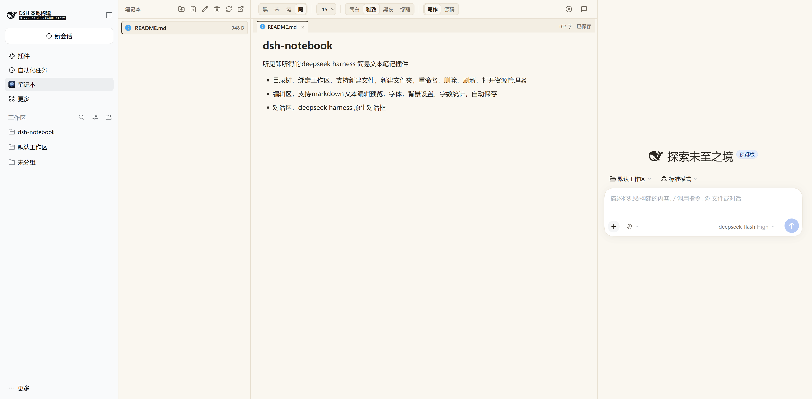

# 笔记本 (dsh-notebook)

所见即所得的deepseek harness简易文本笔记插件

- 目录树，绑定工作区，支持新建文件，新建文件夹，重命名，删除，刷新，打开资源管理器
- 编辑区，支持markdown文本编辑预览，字体，背景设置，字数统计，自动保存
- 对话区，deepseek harness 原生对话框

# 预览效果




## 安装

deepseek harness 对话安装

```
安装 @zmskco/dsh-notebook 这个插件
```

插件选项里面 Github 地址安装

```
https://github.com/zmskco/dsh-notebook
```

插件选项里面 npmjs 名称安装

```
@zmskco/dsh-notebook
```

## 开发

```
pnpm install           # prepare 顺带跑一次 build
pnpm run build         # host(tsc) + client(tsdown) + 产物契约检查
pnpm test              # 类型检查 + 沙箱 + Host 冒烟
pnpm run vendor:icons  # 升级 Material Icon Theme 后重新收录图标（--dry-run 只校验）
npm pack --dry-run     # 看 tarball 内容
```


## 许可

MIT。

面板内的工具栏线性图标来自 [Lucide](https://lucide.dev)（ISC）；

目录树的类型图标来自 [Material Icon Theme](https://github.com/material-extensions/vscode-material-icon-theme)（MIT）；
